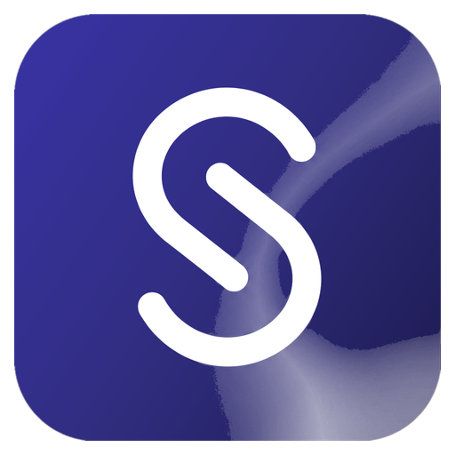

  
  
  # MHC Smart School 🏫
  
  **ระบบสารสนเทศและการบริหารจัดการสถานศึกษาอัจฉริยะแบบครบวงจร (Smart School Management Cloud)**  
  *โรงเรียนมหาชัยพิทยาคาร ตำบลท่าสองคอน อำเภอเมือง จังหวัดมหาสารคาม ๔๔๐๐๐*  
  *สำนักงานเขตพื้นที่การศึกษามัธยมศึกษามหาสารคาม (สพม.มหาสารคาม)*

  [-indigo.svg)](CHANGELOG.md)
  
  [-green.svg)](https://developers.google.com/apps-script)
  
  
  

> 🚀 **เวอร์ชันพัฒนาล่าสุด (Latest Production Release):** **`v3.2.4`** (21 ตุลาคม 2569)  
> • **ผู้อำนวยการโรงเรียน:** **นายอธิการ สุขศรี**  
> • **ผู้จัดทำ / ผู้พัฒนาระบบ:** **ครูก้องนที อุ่นเจริญ**  
> • **GitHub Repository:** `https://github.com/Kongirr12/smc.git`  
> • **PWA Cache Name:** `mhc-smart-school-v3.2.4`

---

## 🌟 แนะนำระบบ (Introduction)

**MHC Smart School** เป็นเว็บแอปพลิเคชันบริหารจัดการสถานศึกษาอัจฉริยะ ออกแบบและพัฒนาเพื่อ **โรงเรียนมหาชัยพิทยาคาร** โดยเฉพาะ โดดเด่นด้วยดีไซน์ Enterprise Portal ระดับพรีเมียม (Dark Obsidian Aurora Theme) รองรับการใช้งานแบบ Responsive 100% บนคอมพิวเตอร์ แท็บเล็ต iPad และสมาร์ตโฟน (iOS / Android) ผ่านเทคโนโลยี Progressive Web App (PWA) 

ระบบครอบคลุมภารกิจงานของโรงเรียนทั้ง 4 ฝ่ายหลัก บันทึกผลการเรียน ปพ.5 อัตโนมัติ เช็คชื่อเข้าเรียนรายคาบ พิมพ์ตารางสอนบนมือถือโดยไม่ออกจากแอป และศูนย์รวมแบบฟอร์มเอกสารมาตรฐาน 30 แบบฟอร์ม พร้อมแปลงเป็นไฟล์ Microsoft Word (.doc) และพิมพ์ A4 พร้อมตราครุฑ

---

## 🚀 ฟีเจอร์หลักของระบบ (Core Features)

### 1. 👥 งานบริหารนักเรียนและห้องเรียน (Students & Classrooms)
* **ข้อมูลนักเรียน (Students):** ค้นหาแบบ Real-time, ตรวจสอบเลขบัตรประชาชนซ้ำ, บันทึกประวัติและข้อมูลผู้ปกครอง, ส่งออกข้อมูลเป็นไฟล์ Excel (.xls)
* **จัดการห้องเรียน (Classrooms):** จัดสรรครูที่ปรึกษา, เลื่อนชั้นเรียนข้ามปีการศึกษาอัตโนมัติ (Auto Promote), ย้ายห้องเรียน
* **จัดเรียงเลขที่นักเรียนอัตโนมัติ (Auto-Assign Roll Numbers):**
  1. *มาตรฐาน สพฐ. / SGS* (ชาย ก-ฮ ก่อน แล้วตามด้วยหญิง ก-ฮ) [แนะนำ]
  2. *เรียงตามตัวอักษร ก-ฮ ทั้งหมด*
  3. *เรียงตามเลขประจำตัวนักเรียน (SGS ID)*
* **แก้ไขเลขที่รายคนแบบ Inline:** คลิกแก้ไขเลขที่ได้ทันทีในหน้าต่างห้องเรียน

### 2. 📅 การเข้าเรียนและพฤติกรรม (Attendance & Behavior)
* **การเช็คชื่อ 2 โหมด:**
  - *โหมดหน้าเสาธง / โฮมรูมตอนเช้า:* เช็คชื่อรายวัน มา/ขาด/ลา/สาย พร้อมปุ่มเช็คด่วนทั้งห้อง
  - *โหมดเช็คชื่อรายวิชา (Smart Sync):* ดึงตารางเรียนจริงของวันนั้นมาเลือกคาบและวิชาให้อัตโนมัติ รองรับการเช็คชื่อควบคู่คาบต่อเนื่อง (2 คาบติด)
* **เช็คชื่อด้วย QR Code อัตโนมัติ:** เปลี่ยนกล้องสมาร์ตโฟน/แท็บเล็ตเป็นเครื่องสแกนบัตรนักเรียน มีระบบ Cooldown ป้องกันการสแกนซ้ำ
* **ระบบคะแนนพฤติกรรม (Student Behavior):** นักเรียนทุกคนมีคะแนนตั้งต้น 100 คะแนน ตัดคะแนนตามฐานความผิด และเพิ่มคะแนนจิตพิสัย/ความดี พร้อมออกใบรายงานพฤติกรรม

### 3. 🪪 พิมพ์บัตรประจำตัวนักเรียน (Student ID Cards)
* ออกแบบบัตรนักเรียนมาตรฐานพร้อมรูปถ่าย
* มี **Barcode Code 128** (สำหรับเครื่องยิงบาร์โค้ด) และ **QR Code** (สำหรับกล้องมือถือสแกนเช็คชื่อ)
* รองรับการสั่งพิมพ์แบบกลุ่ม (Batch Print 8 บัตรต่อหน้ากระดาษ A4) บันทึกเป็น PDF คมชัด

### 4. 🗓️ ระบบตารางสอน & พิมพ์บนมือถือ (Schedule & In-App Printing)
* ดูและจัดตารางสอนประจำชั้น และตารางสอนรายครู
* **โหมด Drag & Drop:** จัดตารางเรียนรวดเร็วด้วยการลากวิชามาวางในคาบเรียนแบบออฟไลน์ แล้วกดบันทึกรวดเดียวขึ้นคลาวด์
* **พิมพ์ตารางสอนบนมือถือโดยไม่ออกจากแอป (In-App Mobile Print):** รองรับ iPhone และ Android มีหน้าต่างพรีวิว A4 แนวนอน พร้อมปุ่ม AirPrint / Save PDF และมีชื่อผู้อำนวยการโรงเรียน **นายอธิการ สุขศรี** กำกับท้ายเอกสารอย่างถูกต้อง

### 5. 📑 ศูนย์รวมแบบฟอร์มเอกสาร 4 ฝ่าย (30 Standard Forms)
บรรจุแบบฟอร์มมาตรฐาน 30 แบบฟอร์ม ครบทั้ง 4 ฝ่ายบริหาร:
* **ฝ่ายบริหารวิชาการ (8 แบบฟอร์ม):** วช.01 - วช.08 (ขออนุมัติแผน, ขอไปราชการ, นิเทศการสอน, สอบแก้ตัว 0 ร มส, ปพ.5 ฯลฯ)
* **ฝ่ายบริหารงบประมาณและแผนงาน (8 แบบฟอร์ม):** งบ.01 - งบ.08 (เสนอโครงการ, จัดซื้อจัดจ้าง, ขอเบิกเงิน, สรุปโครงการ ฯลฯ)
* **ฝ่ายบริหารงานบุคคล (7 แบบฟอร์ม):** บค.01 - บค.07 (ขอลาพักผ่อน, ลาป่วย/กิจ, ขอไปราชการ, วิทยฐานะ วPA ฯลฯ)
* **ฝ่ายบริหารทั่วไป (7 แบบฟอร์ม):** บป.01 - บป.07 (ขอใช้สถานที่, ขอยานพาหนะ, นำนักเรียนออกนอกสถานศึกษา, แจ้งซ่อม ฯลฯ)
* **ความสามารถครบครัน:** ดาวน์โหลดเป็นไฟล์ Word (.doc), สั่งพิมพ์ A4 พร้อมตราครุฑทางการ, แก้ไขเนื้อหาแบบ Inline, และปุ่มกู้คืนค่าเริ่มต้น (Reset Default)

### 6. 📚 งานวิชาการ ทะเบียน และ ปพ.5 (Academic & Grading)
* บันทึกคะแนนระหว่างภาคและปลายภาค คำนวณเกรดสด 0-4 และติด มส อัตโนมัติเมื่อเวลาเรียนต่ำกว่า 80%
* พิมพ์แบบบันทึกผลการเรียน ปพ.5 และ ปพ.6 อัตโนมัติ พร้อมลายเซ็นครูและผู้อำนวยการ
* ระบบรับสมัครนักเรียนและลงทะเบียนเรียน

### 7. 🔗 ระบบเชื่อมโยงภายนอก (Integrated External Apps)
เชื่อมโยงกับระบบเฉพาะทางของโรงเรียนผ่าน Google Apps Script ภายในหน้าเว็บเดียว:
1. **ระบบนิเทศภายใน**
2. **ระบบเยี่ยมบ้านนักเรียน**
3. **ระบบเก็บผลงานครูและข้อมูลการอบรม (E-Portfolio & วPA)**

---

## ⚡ สถาปัตยกรรมและเทคโนโลยี (Architecture & Performance)

* **Frontend:** HTML5, Modern CSS, Tailwind CSS, Vanilla JavaScript (Modular: `js1.js` ถึง `js4.js`, `js_schedule.js`, `js_templates.js` ฯลฯ)
* **Backend:** Google Apps Script (`code.gs`) สถาปัตยกรรม RESTful RPC
* **Database:** Google Sheets ทำหน้าที่เป็น Relational Cloud Database (`Config`, `Users`, `Sessions`, `Students`, `Personnel`, `Attendance`, `Academic`, `Schedule`, `Classrooms`, `Behavior`)
* **Extreme Speed Optimizations:**
  - **Client-Side Micro-Cache (SWR):** แคชข้อมูลอ่านซ้ำด้วย `CACHE_TTL_MAP` แสดงผลทันที 0ms และ Revalidate เบื้องหลัง
  - **O(1) Hash Map Lookups:** ปรับฟังก์ชันการออกรายงานและส่งออก CSV ใน Backend ให้ใช้พจนานุกรม O(1) แทนการวนลูปซ้อน O(N^2)
  - **Direct Cell Updates:** อัปเดตข้อมูลเจาะจงเซลล์ `(idx + 2)` ลดเวลาบันทึกเหลือไม่ถึง 1 วินาที
  - **LockService Concurrency:** ป้องกันข้อมูลชนกันเมื่อมีการบันทึกพร้อมกันหลายผู้ใช้

---

## 📱 Progressive Web App (PWA) & iOS Standalone

* รองรับการบันทึกเป็นไอคอนบนหน้าจอโฮม (Add to Home Screen) ทั้งบน iOS และ Android
* ปรับแต่ง **Dynamic Viewport (`100dvh`)** และ **Safe-Area Inset** ป้องกันติ่งกล้อง Dynamic Island และ Home Indicator bar ชนเนื้อหา
* ไอคอนแอปพลิเคชันดีไซน์ใหม่สไตล์ Dark Obsidian Aurora เข้าชุดกับธีมของระบบ

---

## 👨‍💻 ข้อมูลอัตลักษณ์และลิขสิทธิ์

- **สถานศึกษา:** **โรงเรียนมหาชัยพิทยาคาร** ตำบลท่าสองคอน อำเภอเมือง จังหวัดมหาสารคาม ๔๔๐๐๐
- **ผู้อำนวยการโรงเรียน:** **นายอธิการ สุขศรี**
- **ผู้จัดทำ / ผู้พัฒนาระบบ:** **ครูก้องนที อุ่นเจริญ**
- **สัญญาอนุญาต:** [MIT License](LICENSE)
